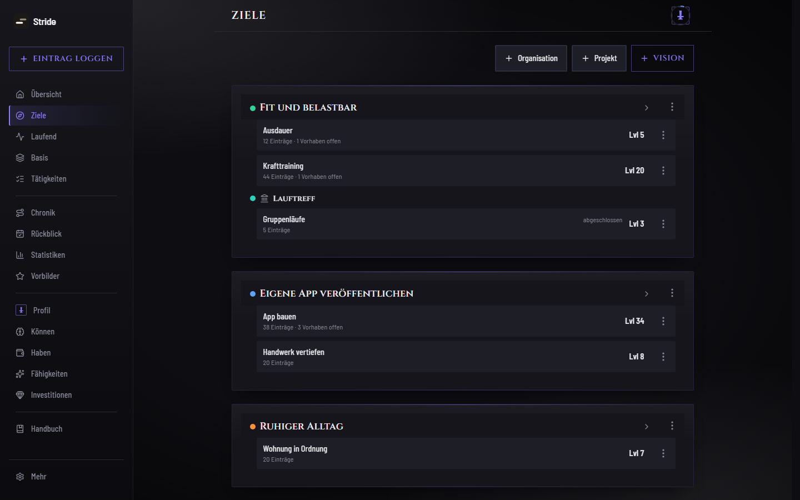

# Stride

Stride ist eine Web-App, die den eigenen Alltag wie ein Rollenspiel führt: Du trägst ein, was du getan hast, bekommst dafür Erfahrungspunkte und steigst mit deinen Zielen und Fähigkeiten im Level auf.



## Funktionen

- **Einträge:** Eine Tätigkeit mit Dauer eintragen bringt XP. Tätigkeiten legst du selbst an und ordnest sie.
- **Ziele:** Visionen, Organisationen und Projekte mit eigenem Level, dazu offene Vorhaben.
- **Tageskette:** Ein Streak für jeden aktiven Tag, mit Schutz bei Pausen und einer Rückkehr nach einer Unterbrechung.
- **Gegner und Bosse:** Vorhaben können als Gegner oder Boss mit Deadline laufen. Ist die Deadline verpasst, kostet das XP.
- **Profil:** Können und Haben als Attribute, ein Baum aus Fähigkeiten, Investitionen, Klassen, Titel und Erfolge. Optional verlieren Attribute ohne Einträge an Wert.
- **Investitionen:** Eine Investition kann XP eines Attributs kosten. Eine eigene Investition oder ein geschafftes Projekt gibt dauerhaft mehr XP.
- **Rückschau:** Chronik aller Einträge, Rückblick und Statistiken.
- **Vorbilder:** Vergleich des eigenen Profils mit bekannten Personen.
- **Basis:** Wiederkehrende Grundaufgaben.
- **Verbindungen:** Erledigte Aufgaben aus Todoist und Termine aus einem Kalender (iCal-Adresse, z. B. Google oder iCloud) werden zu Einträgen.
- **Benachrichtigungen:** Web-Push, wenn der Streak in Gefahr ist, ein Boss ansteht oder eine Rückkehr möglich ist, mit Ruhezeit.
- **Anpassen:** Bereiche lassen sich einzeln abschalten. Ansichten, Farbpaletten und eigene Farben.
- **Sonstiges:** Installierbar als PWA, sieben Sprachen (Deutsch, Englisch, Spanisch, Französisch, Japanisch, Russisch, Chinesisch), Export und Import der Daten, mehrere Konten, Anmeldung mit Passwortmanagern, Handbuch in der App.

Änderungen je Version stehen in [CHANGELOG.md](CHANGELOG.md).

## Technik

- TypeScript, React 19, React Router, TanStack Query, Tailwind CSS 4, Framer Motion, Recharts, Vite
- Server: Node.js (ab 23.6, führt TypeScript direkt aus), Fastify 5, SQLite über `node:sqlite`, Zod, web-push
- Tests: Vitest und Playwright

## Lokal starten

Voraussetzung: Node.js 23.6 oder neuer.

```bash
npm install
npm run dev
```

`npm run dev` startet den Server auf `127.0.0.1:3000` und den Vite-Entwicklungsserver (Standard `http://localhost:5173`), der `/api` an den Server weiterleitet. Beim ersten Aufruf legst du das erste Konto an.

Weitere Befehle:

```bash
npm test               # Unit-Tests (Vitest)
npm run typecheck      # Typprüfung
npm run e2e            # Browser-Tests (brauchen Testkonten in data/)
npm run beispieldaten  # Beispielwelt in data/app.db; schaltet die nötigen Bereiche ein
npm run build          # Produktions-Build nach client/dist
npm start              # Server mit fertigem Build
```

Die Daten liegen in `data/` (`app.db` und `zugang.db`). Liegt `app.db` schon vor, legt `npm run beispieldaten` nichts an. `npm run beispieldaten -- --ersetzen` sichert die alte Datei und baut die Beispielwelt neu. Dafür schaltet das Skript die Bereiche ein, die die Beispielwelt braucht, und aktiviert fehlende Attribute.

### Umgebungsvariablen

| Variable | Zweck |
|---|---|
| `PORT` | Port des Servers, Standard 3000 |
| `DB_PFAD` | Pfad der Datenbank, Standard `data/app.db` |
| `ZUGANG_PFAD` | Pfad der Zugangsdatenbank, Standard `data/zugang.db` |
| `LOG_LEVEL` | Log-Stufe, Standard `warn` |
| `STRIDE_ADMIN` | Benutzername des Admin-Kontos (der alte Name `ASCEND_ADMIN` wird weiter gelesen) |
| `VAPID_PUBLIC_KEY`, `VAPID_PRIVATE_KEY`, `VAPID_SUBJECT` | Schlüssel für Web-Push |
| `STRIDE_TEST` | Nur für Tests: `1` schaltet den Testmodus ein (alter Name `ASCEND_TEST`). Dann setzt `POST /api/test/heute` mit `{ datum }` die Uhr für Kette und Einträge. `datum: null` stellt die echte Uhr wieder her. |

Eine Vorlage mit allen Variablen steht in `.env.example`. Die Werte werden als Umgebungsvariablen gesetzt, zum Beispiel mit `node --env-file=.env`.

## Lizenz

GNU Affero General Public License v3.0, siehe [LICENSE](LICENSE).

## Autor

Leonardo Hramzow, [leohr.de](https://leohr.de), [GitHub](https://github.com/leohr1117)
